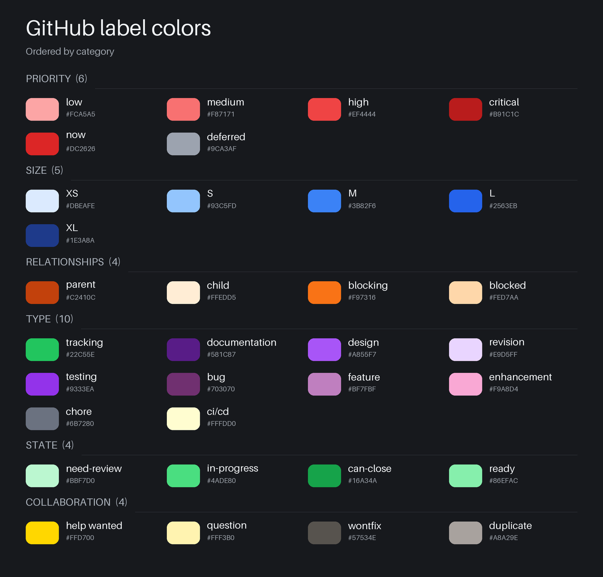
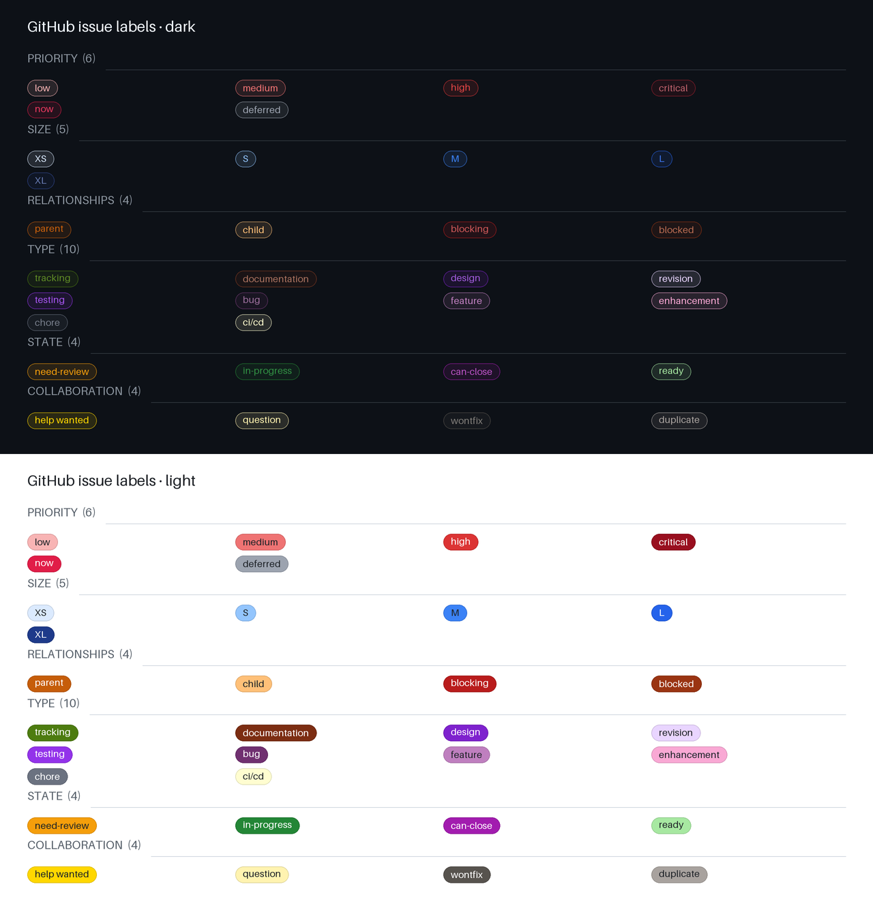

# GitHub labels template

A reusable set of 33 GitHub issue and pull request labels, with two Bash scripts
to apply the template or clear an existing repository's labels.

## Previews

### Color palette



### GitHub label appearance



This preview uses GitHub's component markup and stylesheet captured on October 20,
2026. GitHub's appearance can change with future updates, theme, font, and context.
Both previews are lossless PNG files.

## Files

| File | Purpose |
| --- | --- |
| [labels.json](labels.json) | Portable JSON template containing all 33 label names, colors, and descriptions. |
| [labels/](labels) | Category files that contain the label definitions used by the apply script. |
| [apply-labels.sh](apply-labels.sh) | Creates or updates labels from the category files. |
| [clear-labels.sh](clear-labels.sh) | Deletes every label in the selected repositories. |
| [github-label-colors.png](github-label-colors.png) | Lossless color chart with names and hex codes, ordered by color. |
| [github-label-pills.png](github-label-pills.png) | Lossless browser-rendered preview using GitHub's label component styles in dark and light themes. |

## Requirements

- Bash and [GitHub CLI](https://cli.github.com/).
- A GitHub account with permission to manage labels in each target repository.
- Authentication through `gh auth login`.

Running the shell scripts requires no Python or standalone `jq` installation.
`labels.json` is also provided for tools that import JSON label templates.
The scripts accept `OWNER/REPO` targets on GitHub CLI's configured default host.

## Quick start

Open a terminal in this folder, then authenticate:

```sh
gh auth login
```

Preview the template commands without changing GitHub:

```sh
./apply-labels.sh --dry-run OWNER/REPO
```

Apply the template:

```sh
./apply-labels.sh OWNER/REPO
```

Replace `OWNER/REPO` with your repository, for example `octocat/my-project`.
The apply script creates missing labels and updates the color and description of
matching labels. Other existing labels and existing issue assignments are preserved.
You can rerun it whenever you update the template.

If executable permissions were lost when copying the files, run:

```sh
chmod +x apply-labels.sh clear-labels.sh
```

## Apply a subset of labels

By default `apply-labels.sh` applies every category. Pass one or more category
options to apply only those labels:

```sh
./apply-labels.sh --priority --state OWNER/REPO
./apply-labels.sh --size OWNER/REPO
```

Available categories, in application order:

| Option | Labels |
| --- | --- |
| `--priority` | low, medium, high, critical, now, deferred |
| `--size` | XS, S, M, L, XL |
| `--relationships` | parent, child, blocking, blocked |
| `--type` | tracking, documentation, design, revision, testing, bug, feature, enhancement, chore, ci/cd |
| `--state` | need-review, in-progress, tracking, can-close, ready |
| `--collab` | help wanted, question, wontfix, duplicate |

`documentation` is the existing name for docs, and `medium` is the existing name
for med. Categories are applied in the order shown, regardless of the order of
the options. A label shared by multiple selected categories is applied once.

Use `--all` to reset the selection to every category:

```sh
./apply-labels.sh --priority --all OWNER/REPO
```

Category options work with `--dry-run` and multiple repositories.

## Replace all existing labels

**Clearing deletes every repository label, including automatically generated labels,
and removes those labels from existing issues and pull requests. The script does
not prompt for confirmation. Recreating labels does not restore their assignments.**

Preview the deletions first:

```sh
./clear-labels.sh --dry-run OWNER/REPO
```

Then clear and apply the template:

```sh
./clear-labels.sh OWNER/REPO && ./apply-labels.sh OWNER/REPO
```

The clear script fetches all pages of labels before deleting any labels in each
repository. Its dry run reads GitHub to list existing labels but makes no changes.
The apply script's dry run only prints commands and does not contact GitHub.

## Multiple repositories

Both scripts accept multiple repository arguments:

```sh
./apply-labels.sh OWNER/REPO1 OWNER/REPO2
./clear-labels.sh --dry-run OWNER/REPO1 OWNER/REPO2
```

Use `--dry-run` before the repository arguments. Run either script with `--help`
to see its usage.

## Label reference

The template is available in `labels.json` and the category files under `labels/`.

| Label | Hex color | Description |
| --- | --- | --- |
| `low` | `#F8B4B4` | Low priority |
| `medium` | `#EF7373` | Medium priority |
| `high` | `#DC3434` | High priority |
| `critical` | `#990F1F` | Critical priority; requires immediate attention |
| `now` | `#E11D48` | Needs to be addressed now |
| `deferred` | `#9CA3AF` | Postponed for later consideration |
| `XS` | `#DBEAFE` | Extra small effort or scope |
| `S` | `#93C5FD` | Small effort or scope |
| `M` | `#3B82F6` | Medium effort or scope |
| `L` | `#2563EB` | Large effort or scope |
| `XL` | `#1E3A8A` | Extra large effort or scope |
| `chore` | `#6B7280` | Routine maintenance or housekeeping |
| `bug` | `#703070` | Something is not working as expected |
| `feature` | `#BF7FBF` | New functionality |
| `enhancement` | `#68A9E8` | Improvement to existing functionality |
| `documentation` | `#153E75` | Documentation additions or improvements |
| `testing` | `#8B5CF6` | Tests, test coverage, or quality verification |
| `revision` | `#A4C8F0` | Changes or rework to existing implementation |
| `design` | `#397BC6` | Design, user experience, or architecture work |
| `ci/cd` | `#FFFDD0` | Continuous integration, delivery, or deployment |
| `tracking` | `#2A9D8F` | Tracks ongoing work, progress, or follow-up |
| `help wanted` | `#FFD700` | Contributions or additional assistance welcome |
| `question` | `#FFF3B0` | A question or clarification is needed |
| `wontfix` | `#57534E` | This will not be worked on |
| `duplicate` | `#A8A29E` | This duplicates another issue |
| `need-review` | `#F59E0B` | Awaiting review |
| `in-progress` | `#238636` | Work is actively underway |
| `can-close` | `#0E7490` | Work is complete and can be closed |
| `ready` | `#A7E8A1` | Ready for work to begin |
| `parent` | `#C65D0A` | Tracks a larger body of work with child issues |
| `child` | `#FFC078` | A subtask belonging to a parent issue |
| `blocking` | `#B91C1C` | Blocks other work from progressing |
| `blocked` | `#9A3412` | Blocked by other work |

## Customize the template

Edit the category files under `labels/`. Each line has this format:

```text
name|RRGGBB|Description
```

Categories are applied in this order: priority, size, relationships, type, state,
and collab. A label may appear in more than one category; it is applied only once.
Use a six-digit hex color without `#`. Keep each label on one line and avoid `|`
in names or descriptions. Keep `labels.json` synchronized with the category files.
Reapply the script to update your repositories.
Removing a template entry does not delete an existing repository label.
The PNG previews are static exports and must be regenerated after template changes.

## Errors and recovery

The scripts stop on a failed GitHub CLI command. Changes completed before the
failure remain applied; there is no rollback. Resolve the reported authentication,
permission, or API error, then rerun the appropriate script. Applying the template
again safely updates matching labels; clearing again processes labels that remain.
